# Gate

**La gestion de votre salle, de l'inscription au contrôle d'accès.**


<p align="center">
  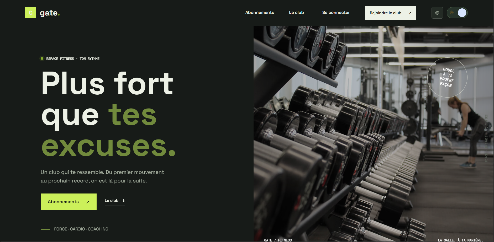
</p>

## Sommaire

1. [Présentation](#1-présentation)
2. [Aperçu](#2-aperçu)
3. [Fonctionnalités par rôle](#3-fonctionnalités-par-rôle)
4. [Stack technique](#4-stack-technique)
5. [Architecture et dépôt](#5-architecture-et-dépôt)
6. [Prérequis](#6-prérequis)
7. [Installation et lancement local](#7-installation-et-lancement-local)
8. [Premier démarrage](#8-premier-démarrage)
9. [Tests](#9-tests)
10. [Tunnel de démonstration Cloudflare](#10-tunnel-de-démonstration-cloudflare)
11. [Sécurité et limites connues](#11-sécurité-et-limites-connues)
12. [Dépannage](#12-dépannage)
13. [Migrations](#13-migrations)
14. [Documentation](#14-documentation)
15. [Perspectives d'amélioration](#15-perspectives-damélioration)
16. [Auteur](#16-auteur)

## 1. Présentation

Gate regroupe les opérations courantes d'une salle de sport dans une application web : gestion des membres, des abonnements, des cours, du coaching et du contrôle d'accès par reconnaissance faciale. Elle s'adresse aux équipes de salle (administration, réception et coachs) ainsi qu'aux membres qui gèrent leur activité.

L'application distingue quatre rôles : **Admin**, **Réception**, **Coach** et **Membre**. Les droits sont contrôlés côté API Spring, jamais uniquement dans l'interface.

**Points clés**

- Site public avec offres, inscription et connexion (mot de passe, Google ou visage).
- Abonnements, cours collectifs, réservations, séances et demandes de coaching.
- Suivi de progression et objectifs côté membre, notes privées côté coach.
- Contrôle d'accès à la salle par reconnaissance faciale, avec journal d'accès.
- Interface en français, anglais et arabe (RTL), thèmes clair et sombre, responsive.

## 2. Aperçu

> Les captures sont stockées dans `docs/screenshots/`. Les données affichées sont des données de démonstration.

### Site public et authentification

<table>
  <tr>
    <td align="center"><strong>Accueil</strong><br><a href="docs/screenshots/01-accueil.png"></a></td>
    <td align="center"><strong>Formules</strong><br><a href="docs/screenshots/02-formules.png">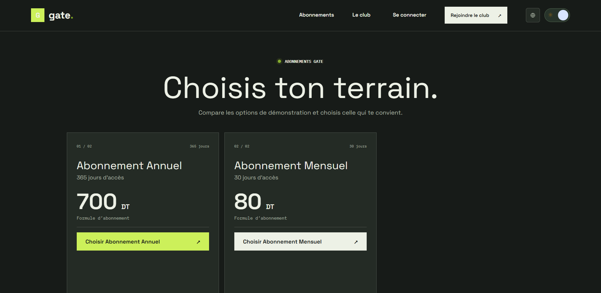</a></td>
  </tr>
  <tr>
    <td align="center"><strong>Connexion</strong><br><a href="docs/screenshots/03-connexion.png">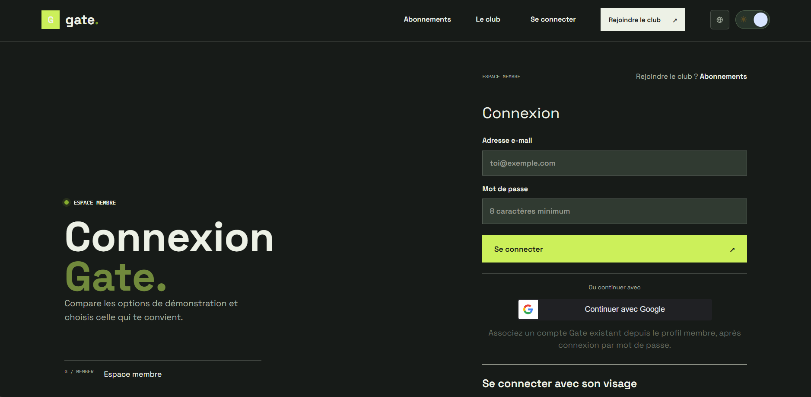</a></td>
    <td></td>
  </tr>
</table>

### Espace membre

<table>
  <tr>
    <td align="center"><strong>Tableau de bord</strong><br><a href="docs/screenshots/04-membre-dashboard.png">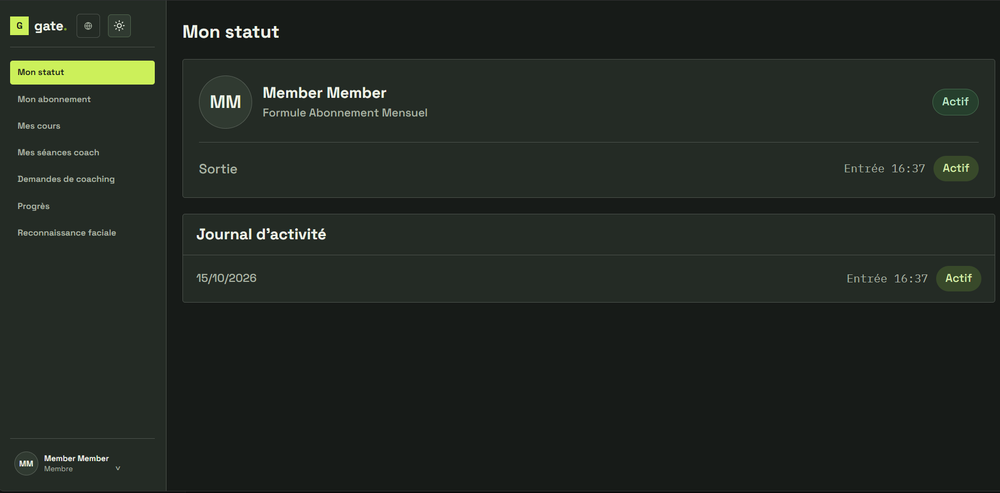</a></td>
    <td align="center"><strong>Réservation de cours</strong><br><a href="docs/screenshots/05-membre-cours.png">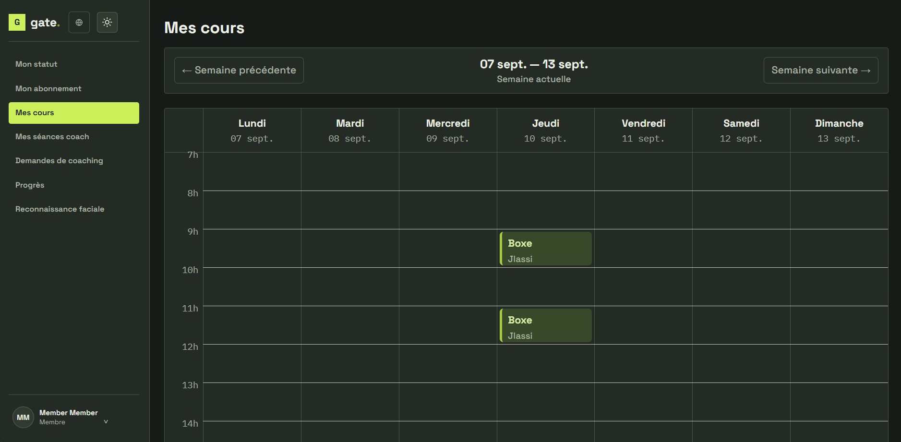</a></td>
  </tr>
  <tr>
    <td align="center"><strong>Progression et objectifs</strong><br><a href="docs/screenshots/06-membre-progression.png">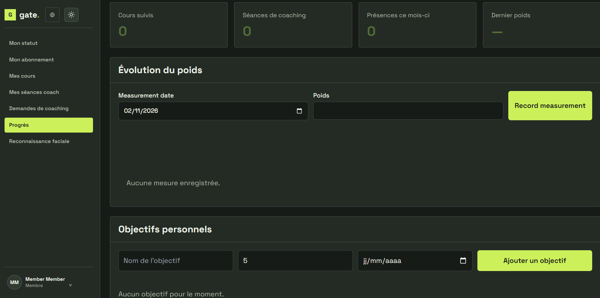</a></td>
    <td></td>
  </tr>
</table>

### Espace administration et réception

<table>
  <tr>
    <td align="center"><strong>Tableau de bord admin</strong><br><a href="docs/screenshots/07-admin-dashboard.png">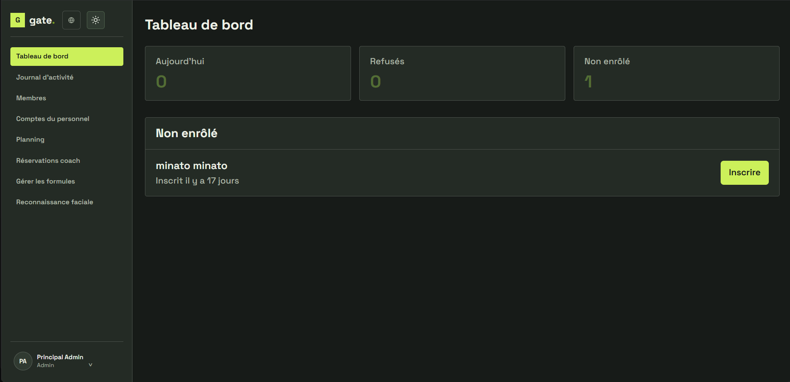</a></td>
    <td align="center"><strong>Gestion des membres</strong><br><a href="docs/screenshots/08-admin-membres.png">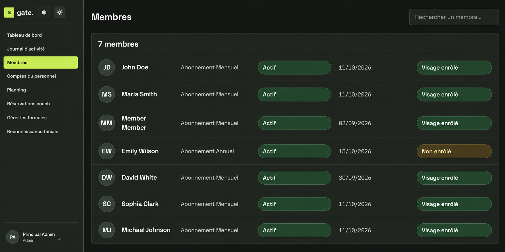</a></td>
  </tr>
  <tr>
    <td align="center"><strong>Comptes du personnel</strong><br><a href="docs/screenshots/09-admin-personnel.png">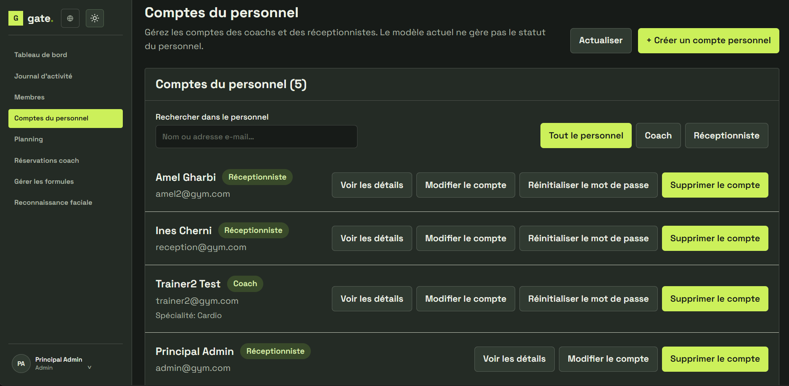</a></td>
    <td align="center"><strong>Journal d'accès</strong><br><a href="docs/screenshots/11-journal-acces.png">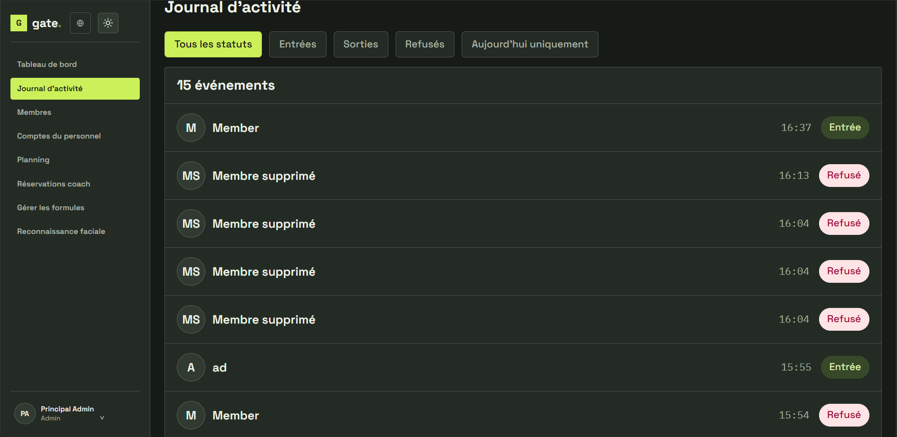</a></td>
  </tr>
  <tr>
    <td align="center"><strong>Accueil réception</strong><br><a href="docs/screenshots/12-reception-accueil.png">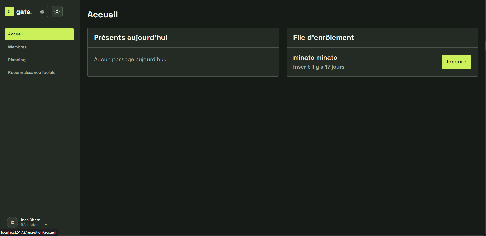</a></td>
    <td></td>
  </tr>
</table>

### Reconnaissance faciale

<p align="center">
  <a href="docs/screenshots/13-controle-acces.png">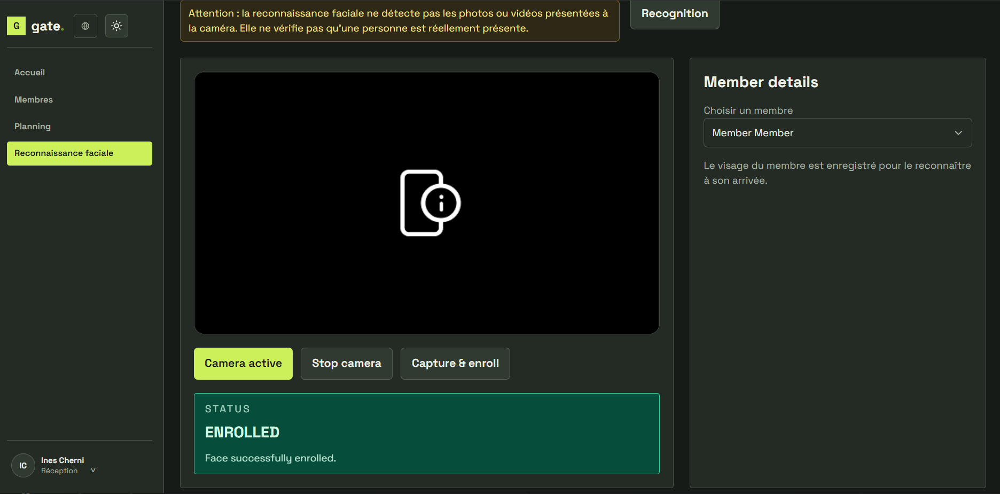</a><br>
  <strong>Contrôle d'accès</strong>
</p>

### Espace coach

<p align="center">
  <a href="docs/screenshots/16-coach-fiche-client.png">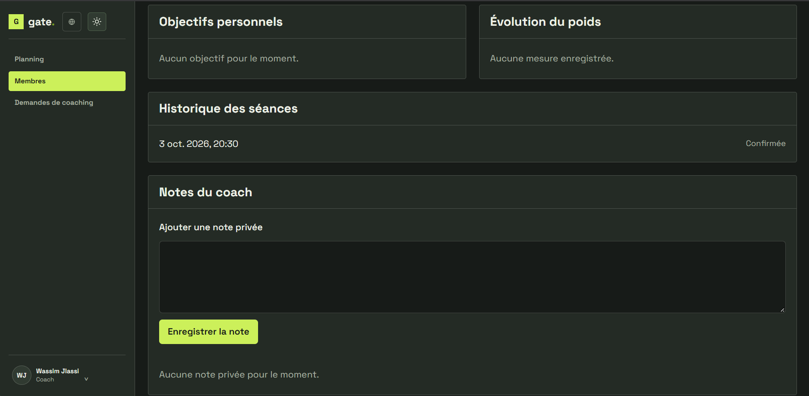</a><br>
  <strong>Fiche client et notes privées</strong>
</p>

## 3. Fonctionnalités par rôle

- **Admin** : gérer les membres, les comptes du personnel (création, édition, réinitialisation de mot de passe), les formules et le planning; consulter le journal d'accès; enrôler un membre et contrôler son accès par reconnaissance faciale.
- **Réception** : consulter l'annuaire des membres (lecture seule) et le planning, faciliter l'accueil et effectuer le contrôle d'accès facial.
- **Coach** : consulter son planning et ses clients associés, traiter les demandes de coaching, suivre les séances et tenir des notes privées sur ses clients.
- **Membre** : créer un compte, gérer son profil et sa photo, choisir et consulter son abonnement, réserver des cours, demander des séances de coaching, suivre sa progression et ses objectifs.
- **Authentification et préférences** : connexion par mot de passe, Google ou visage; interface en français, anglais ou arabe (écriture de droite à gauche), thèmes clair et sombre.

### Matrice des accès

| Domaine | Public | Admin | Réception | Coach | Membre |
|---|:---:|:---:|:---:|:---:|:---:|
| Consulter formules actives, cours et planning | ✅ | ✅ | ✅ | ✅ | ✅ |
| Gérer les formules | | ✅ | | | |
| Gérer cours et planning | | ✅ | ✅ | | |
| Gérer les membres | | ✅ | ✅ | | |
| Gérer les comptes du personnel | | ✅ | | | |
| Consulter ses clients associés et ses notes privées | | | | ✅ | |
| Réserver, suivre sa progression, ses objectifs | | | | | ✅ (ses données) |
| Journal d'accès, enrôlement et contrôle facial | | ✅ | ✅ | | |

Le détail complet des permissions par endpoint est dans [AIDE.md](./AIDE.md).

### Connexion faciale selon le rôle

| Rôle | Connexion par le visage | Autres usages du visage |
|---|---|---|
| Membre | Oui, après enrôlement de son propre visage | Peut être enrôlé par le personnel pour l'accès à la salle |
| Réception | Oui, après enrôlement de son propre visage | Enrôle les membres et effectue le contrôle d'accès |
| Admin | Bloquée par défaut (sécurité) | Enrôle les membres et effectue le contrôle d'accès |
| Coach | Non disponible : connexion par mot de passe ou Google | Aucun |

L'enrôlement d'un membre et le contrôle d'accès à la salle sont réservés à l'Admin et à la Réception. Un accès physique exige en plus un abonnement actif et non expiré.

## 4. Stack technique

| Domaine | Technologies |
|---|---|
| Frontend | React 18.2, React Router 6.23, Vite 5.2, Tailwind CSS 3.4 |
| Backend | Java 21, Spring Boot 4.1.0, Spring Security (JWT), Spring Data JPA, Maven Wrapper 3.9.16 |
| Base de données | MySQL 8, Flyway |
| Service facial | Python 3.11, Flask 3.0.3, `face-recognition` 1.3.0, NumPy 2.1.3, Pillow 10.4.0 |
| Tests | JUnit / Spring Boot Test, tests Node intégrés (`node:test`), tests Python `unittest` |

## 5. Architecture et dépôt

```text
Navigateur React
      │ /api (proxy Vite en développement)
      ▼
API REST Spring Boot ─────────► MySQL
      │
      └── API d'embedding facial ──► service Flask
```

Le navigateur capture l'image; l'API Spring applique les règles d'authentification, de rôle et d'accès, puis appelle le service Flask pour calculer une empreinte faciale (embedding). Les empreintes et les journaux associés sont gérés par le backend et stockés dans MySQL. Le service Flask ne porte ni comptes, ni rôles, ni règles d'accès.

```text
/
├── AIDE.md                         # Documentation détaillée du comportement et du lancement
├── README.md                       # Ce fichier
├── docs/
│   └── screenshots/                # Captures d'écran utilisées dans ce README
├── backend/
│   ├── pom.xml, mvnw, mvnw.cmd     # Dépendances et wrapper Maven
│   ├── DATABASE_MIGRATIONS.md      # Procédure et conventions Flyway
│   └── src/
│       ├── main/java/              # API, sécurité, métier et accès aux données
│       ├── main/resources/         # Configuration et migrations SQL
│       └── test/java/              # Tests backend
├── facial-recognition/
│   ├── main.py                     # API Flask d'embedding et de santé
│   ├── requirements.txt            # Dépendances Python épinglées
│   └── test_main.py                # Tests du service facial
└── frontend/
    ├── package.json                # Scripts et dépendances npm
    ├── vite.config.js              # Port et proxy de développement
    └── src/                        # Application React, pages, contextes et services API
```

## 6. Prérequis

- **Java 21** (le wrapper Maven est inclus).
- **Node.js 24** et npm : version utilisée pour le développement (v24.21.0). Aucune version minimale n'est déclarée dans le projet.
- **Python 3.11** : version utilisée pour le développement (3.11.9). Les versions des bibliothèques figurent dans `facial-recognition/requirements.txt`.
- **MySQL 8** : utilisez un serveur MySQL 8, pas la MariaDB fournie avec certaines installations XAMPP (Hibernate ne la supporte plus correctement).
- La bibliothèque `face-recognition` dépend de dlib. Son installation sous Windows peut être délicate et demande un compilateur C++ et beaucoup de mémoire.
- Une webcam et l'autorisation du navigateur pour les parcours de capture faciale.

## 7. Installation et lancement local

Les exemples sont à exécuter dans des terminaux PowerShell séparés, depuis la racine du dépôt. Définissez les variables d'environnement dans votre environnement local et ne placez aucun secret dans Git. Les fichiers `.env.example` sont des modèles de noms et ne sont pas chargés automatiquement par le backend.

### 7.1 Préparer MySQL

Démarrez MySQL 8, puis créez la base :

```sql
CREATE DATABASE gymbd;
```

Si votre serveur diffère, renseignez `DB_URL`, `DB_USERNAME` et `DB_PASSWORD`. Au démarrage, Flyway applique les migrations et Hibernate valide le schéma.

### 7.2 Variables d'environnement

Les exemples sont laissés vides volontairement.

| Nom | Rôle | Obligatoire ? | Exemple |
|---|---|---:|---|
| `SERVER_PORT` | Port de l'API Spring | Non | *(vide)* |
| `DB_URL` | URL JDBC de MySQL | Non (valeur par défaut) | *(vide)* |
| `DB_USERNAME` | Compte MySQL | Selon la configuration | *(vide)* |
| `DB_PASSWORD` | Mot de passe MySQL | Selon la configuration | *(vide)* |
| `JWT_SECRET` | Signature des sessions (32 caractères minimum) | **Oui** | *(vide)* |
| `GOOGLE_CLIENT_ID` | Vérification de la connexion Google côté API | Seulement si Google est utilisé | *(vide)* |
| `ALLOWED_ORIGINS` | Origines autorisées (CORS) | Non (origines locales par défaut) | *(vide)* |
| `APP_UPLOAD_DIR` | Dossier des photos de profil | Non | *(vide)* |
| `FACE_RECOGNITION_URL` | URL du service Flask appelée par Spring | Non (adresse locale par défaut) | *(vide)* |
| `FACE_SERVICE_KEY` | Clé partagée entre Spring et Flask | Non en local; requise hors local | *(vide)* |
| `SEED_ADMIN_PASSWORD` | Mot de passe du compte Admin créé en profil `dev` | Non | *(vide)* |
| `SEED_RECEPTIONIST_PASSWORD` | Idem pour la Réception | Non | *(vide)* |
| `SEED_TRAINER_PASSWORD` | Idem pour le Coach | Non | *(vide)* |
| `SEED_MEMBER_PASSWORD` | Idem pour le Membre | Non | *(vide)* |
| `VITE_API_URL` | Préfixe API du frontend; vide pour utiliser le proxy Vite `/api` | Non | *(vide)* |
| `VITE_GOOGLE_CLIENT_ID` | Identifiant public Google | Seulement si Google est utilisé | *(vide)* |
| `PORT` | Port du service facial | Non | *(vide)* |
| `HOST` | Adresse d'écoute du service facial | Non | *(vide)* |

Le backend importe facultativement `frontend/.env.local`; Vite y lit aussi ses variables `VITE_*`. Après toute modification, redémarrez les processus concernés.

### 7.3 Démarrer le backend

Le profil `dev` active le seeder de données de développement.

```powershell
Set-Location .\backend
.\mvnw.cmd "-Dspring-boot.run.profiles=dev" spring-boot:run
```

### 7.4 Démarrer le service de reconnaissance faciale

```powershell
Set-Location .\facial-recognition
python -m venv .venv
.\.venv\Scripts\Activate.ps1
python -m pip install -r requirements.txt
python main.py
```

### 7.5 Démarrer le frontend

```powershell
Set-Location .\frontend
npm install
npm run dev
```

### URLs locales

| Service | URL / port |
|---|---|
| Frontend | `http://localhost:5173` |
| API Spring | `http://localhost:8080` |
| Santé du service facial | `http://127.0.0.1:8001/health` |

La webcam fonctionne sur `localhost`; autorisez son accès dans le navigateur lors de la capture.

## 8. Premier démarrage

Pour obtenir un compte Membre, utilisez l'inscription publique et choisissez une formule. En profil `dev`, le seeder crée aussi des comptes de développement pour les rôles prévus. Définissez les variables `SEED_*_PASSWORD` avant le premier démarrage pour connaître leurs mots de passe; n'écrivez ni identifiants ni mots de passe dans ce README.

Si ces variables ne sont pas définies, des mots de passe aléatoires sont générés. Ne partagez pas les journaux de démarrage.

**Parcours conseillé pour découvrir l'application**

1. Connectez-vous en Admin, créez ou vérifiez une formule et un cours planifié.
2. Inscrivez un membre depuis `/signup`, ou utilisez le compte Membre de développement.
3. Enrôlez le visage du membre depuis l'espace Admin ou Réception, puis testez le contrôle d'accès.
4. Consultez le journal d'accès pour voir la décision enregistrée.

## 9. Tests

Exécutez les commandes dans le dossier du composant concerné :

| Composant | Commande |
|---|---|
| Backend | `.\mvnw.cmd test` depuis `backend/` (MySQL doit être démarré) |
| Frontend | `npm test` depuis `frontend/` |
| Build frontend | `npm run build` depuis `frontend/` |
| Service facial | `python -m unittest discover -s . -p "test_*.py"` depuis `facial-recognition/` |

Les résultats vérifiés et les zones encore peu couvertes sont suivis dans [AIDE.md](./AIDE.md).

## 10. Tunnel de démonstration Cloudflare

Le tunnel rapide expose Vite sur le port `5173`; le proxy Vite relaie `/api` vers Spring sur `8080`.
Laissez le backend et le frontend actifs, puis lancez `cloudflared tunnel --url http://localhost:5173` dans un troisième terminal.
Ouvrez l'adresse HTTPS temporaire affichée; elle change à chaque lancement.
N'exposez pas directement les ports `8080` ou `8001`; détails et précautions dans [AIDE.md](./AIDE.md).

## 11. Sécurité et limites connues

- La reconnaissance faciale ne comporte **pas de détection de vivacité** : une photo ou une vidéo présentée à la caméra peut tromper la capture. La connexion faciale des comptes Admin est bloquée par défaut.
- Les abonnements sont une démonstration, sans prestataire ni paiement réel : un statut actif ne signifie pas qu'un paiement a été encaissé.
- Les sessions expirent après **24 heures**.
- Les empreintes faciales sont des données biométriques sensibles : limitez leur accès et ne partagez ni les données ni les journaux.
- Pour tout accès non local au service facial, protégez-le avec `FACE_SERVICE_KEY` et n'exposez pas son port.
- Le jeton de session est conservé dans le `localStorage` du navigateur, avec le risque habituel en cas de faille XSS.
- Aucune limitation de débit ni authentification multifacteur n'est en place.

## 12. Dépannage

| Symptôme | Piste |
|---|---|
| L'API ne démarre pas, erreur de connexion à la base | Vérifiez que MySQL 8 est démarré, que la base `gymbd` existe et que `DB_URL`, `DB_USERNAME`, `DB_PASSWORD` sont corrects. |
| Erreur Hibernate/dialecte avec XAMPP | Vous utilisez probablement MariaDB : installez MySQL 8. |
| L'API refuse de démarrer sans secret | Définissez `JWT_SECRET` (32 caractères minimum). |
| Le frontend affiche une erreur réseau vers `:8080` | L'API locale n'est pas démarrée ou n'est pas joignable. |
| Bouton Google refusé (403) | Ajoutez l'origine exacte utilisée (`http://localhost:5173` ou `http://127.0.0.1:5173`) dans Google Auth Platform. |
| API Google en 503 | `GOOGLE_CLIENT_ID` manquant côté backend ou vérification Google indisponible. |
| Webcam inaccessible | Utilisez `localhost` (ou HTTPS) et autorisez la caméra dans le navigateur. |
| Reconnaissance impossible, erreur du service facial | Vérifiez que Flask tourne sur `8001` et que `FACE_SERVICE_KEY` est identique côté Spring et Flask. |
| Échec d'installation de `face-recognition` | dlib exige un compilateur C++ et de la mémoire, surtout sous Windows. |
| Après modification de `.env.local` rien ne change | Redémarrez Vite et l'API. |

## 13. Migrations

Flyway gère le schéma MySQL à partir de migrations versionnées dans `backend/src/main/resources/db/migration`. Hibernate valide le schéma sans le créer ni le modifier. Avant de migrer une base existante, sauvegardez-la et suivez [backend/DATABASE_MIGRATIONS.md](./backend/DATABASE_MIGRATIONS.md). Ne modifiez jamais une migration déjà appliquée : ajoutez-en une nouvelle.

## 14. Documentation

Pour les routes, rôles, règles métier, modèle de données, catalogue d'API, détails d'installation et limites, consultez [AIDE.md](./AIDE.md).

## 15. Perspectives d'amélioration

- Ajouter un parcours de paiement réel et son traitement sécurisé.
- Mettre en place une détection de vivacité pour les parcours biométriques.
- Fiabiliser la capacité des cours face aux réservations concurrentes.
- Conteneuriser le projet et documenter le déploiement de production.
- Ajouter pagination et filtres pour les grands volumes.
- Ajouter des notifications (réservations, abonnements, demandes de coaching).
- Ajouter des tests de bout en bout du parcours navigateur.

## 16. Auteur

- **Auteur :** Khaldi Omar, étudiant à la Faculté des Sciences de Bizerte
- **Année :** 2026